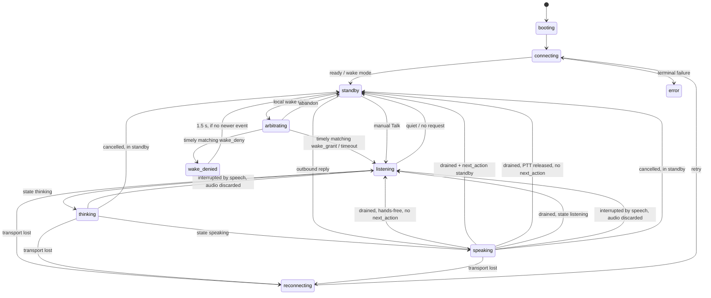

# Arya state animations

Every Arya client shows the same voice states with the same meaning, so a
person who knows one device can read any other. Devices differ in what they
can draw: a menu-bar mark, a phone screen, an LED ring, a single LED. Each
device renders a state in the way that suits its hardware.

Consistent on every device:

- The state being shown and what it means.
- The state's color.
- The character of its motion: steady, breathing, pulsing, or travelling.
- Mute and faults are always visible.

Free to differ per device:

- Geometry, size, and the exact shape of the animation.
- Exact timing. The durations below are the defaults; a device adapts them to
  its frame rate and LED count while keeping the motion recognizable.
- Extra channels such as text, icons, level meters, a face, or haptics.

## States

A device shows one state at a time.

| State | Meaning | Color | Animation |
|---|---|---|---|
| `booting` | Starting up | Neutral | One 400 ms fade-in |
| `unconfigured` | Connection or settings required | Blue | Travelling chase, 1.38 s per lap, until configured |
| `connecting` | Opening the connection or awaiting `ready` | Blue | Smooth 1.6 s breath |
| `reconnecting` | Connection lost; retrying | Orange | Two 180 ms pulses 180 ms apart, then a 1.46 s rest |
| `idle` | No active session and no wake detector | Neutral | Small, gently breathing or twinkling mark |
| `standby` | Connected; waiting for the wake word or manual Talk | Neutral | Small, gently breathing or twinkling mark |
| `arbitrating` | Wake word heard; waiting for a matching decision | Orange | Smooth 1 s breath between 35% and 100% brightness |
| `wake_denied` | Matching `wake_deny` received before the deadline | Red | Steady for 1.5 s, then standby |
| `listening` | Wake granted or timed out, manual Talk, follow-up listening, or waiting for an approval answer | Green | Steady, with a meter driven by the microphone level where the device can show one |
| `thinking` | The agent turn has started | Orange | Clearly animated: an orbit on a ring or screen, a breath on a single LED |
| `speaking` | Reply playing, including its local tail | Speaking blue | Large and prominent, driven by the reply audio level where the device can show it |
| `error` | Connection, authentication, capture, or playback failure | Fault red | Persistent pulse, with error text or a warning symbol where available |
| `ended` | Session explicitly ended | Neutral | 600 ms fade to idle |

An orange travelling animation always means thinking. Faults pulse and never
rotate: rotation means work is in progress. Idle and
standby motion stays small and slow so it does not look like an input meter.
A level meter always shows real audio: microphone input while listening, reply
output while speaking.

### Colors

| Token | sRGB |
|---|---|
| Neutral | `#FFFFFF` on dark surfaces, `#111111` on light surfaces |
| Orange | `#FF9500` |
| Green | `#34C759` |
| Speaking blue | `#32ADFF` |
| Blue | `#3478F6` |
| Fault red | `#FF3B30` |
| Violet | `#AF52DE` |

LED devices apply their own brightness and gamma calibration to reach these
colors. Brightness, night mode, and ambient-light adjustment dim the output
without changing the color's meaning.

## Transitions

The frames named here are defined in [client.md](client.md).

- A wake timeout is not a denial: enter listening without showing red, unless
  the activation was abandoned under the safety rules in [client.md](client.md).
  Late decisions do not change the state or replay a cue.
- `ready` alone does not grant a wake. Manual Talk enters listening without
  arbitration. An outbound reply enters speaking directly from standby.
- Listening that manual Talk opened ignores `quiet` until the person's first
  request; after that, `quiet` returns to standby as usual.
- Stay in speaking until local playback has drained, even after `turn_done`.
  Apply `next_action` after the drain; do not show green while reply audio is
  still queued.
- During a turn, show the state the server sends in its `state` frame. One that
  arrives while reply audio is still playing applies once that audio has
  drained. So an approval shows speaking while its question plays, listening
  while the server waits for the answer, and thinking once it is answered.
- Stay in listening after the user stops speaking, until a `state` of
  `thinking` arrives. No frame marks the end of speech.
- A `thinking` frame keeps thinking alive. It never changes the state.
- `interrupted` discards queued audio. The state that follows is in the client
  spec ("Handling `turn_done.next_action`"): speech that interrupted leads to
  listening; the device's own `cancel` leaves it as it was. It is not an error.
- A new state replaces the old one immediately and cancels its timers,
  including the 1.5 s denial timer.
- Animation only reflects state. It never delays audio, grants a wake, or
  decides that speech is an interruption.

## Mute and overlays

Mute and Do Not Disturb are shown alongside the state, not in place of it.

- **Muted:** steady red, softer than fault red, with a microphone-off label
  where text is available. Never show green listening while muted, and stop the
  input meter. Reply playback may continue, with the mute indication kept
  visible. A single LED shows the mute red.
- **Unmuted:** remove the red once the microphone is available and show the
  current state.
- **Error while muted:** keep the mute indication and show the error with text,
  a symbol, or the fault pulse.
- **Do Not Disturb:** violet badge, or a 1.76 s violet pulse on entry. This is
  not microphone mute.
- **Volume:** neutral proportional bar for 1.5 s. Assistant volume, where it is
  a separate control, uses a speaking-blue bar.

On a device with a single surface, the order of priority is mute and faults,
then volume, then the voice state, then ambient effects. When an overlay ends,
show the current state.

## Other indications

A device shows these only if it has the feature.

| Indication | Color | Animation |
|---|---|---|
| Identify | Rainbow | 2 s color cycle |
| Bluetooth pairing | Blue | Chase, about 1 s per lap |
| Outgoing call | Green | 900 ms orbit |
| Incoming call | Green | 1.3 s pulse |
| Active call | Green | 2.4 s travelling wave |
| Call ended | Green | 1.5 s fade, then the current state |
| Countdown ringing | Device's alert style | Persistent until stopped; distinct from listening |
| Factory reset confirmation | Orange | 830 ms pulse |
| Sign-in pending | Blue | 1.8 s breath |

Ambient light effects, face blinks and glances, and user themes never cover a
voice state, mute, or a fault. A theme may change geometry and style; it keeps
the state colors and meanings.

## Device adaptations

| Device | Rendering |
|---|---|
| macOS menu mark | The `)` arc stays visible in every state. The dot takes the state color and animation; larger animations such as thinking and mute also color and animate the arc. The level meter sits beside the dot. The mark stays legible on light and dark menu bars. |
| iOS orb | The orb and rings take the state color. The waveform shows the microphone level while listening and the reply level while speaking. A label names the state and microphone status. |
| LED ring (Voice PE, Echo) | Travelling states orbit the ring. Where the device knows the talker's direction, listening points toward the talker. |
| LED groups (Echo Pyramid) | The four groups mirror the same state. Travelling states may breathe instead. |
| Echo screen band | The ring unrolled into a band with the talker at the center, using the ring's colors and timing. |
| Echo face | Eyes and mouth express the state: attentive while listening, searching while thinking, mouth moving with the reply while speaking. The face uses the state color and agrees with the band. |
| Single LED (Echo Input) | Travelling states breathe or pulse instead. Color and brightness carry the state. |

When Reduce Motion is enabled, show a static state color with text, an icon,
or a shape, and a non-animated level where practical.

Animations run from a monotonic clock so their periods do not depend on frame
rate. Rendering never blocks audio capture, network audio, or playback.

The tones that accompany these states are in [tones.md](tones.md).
