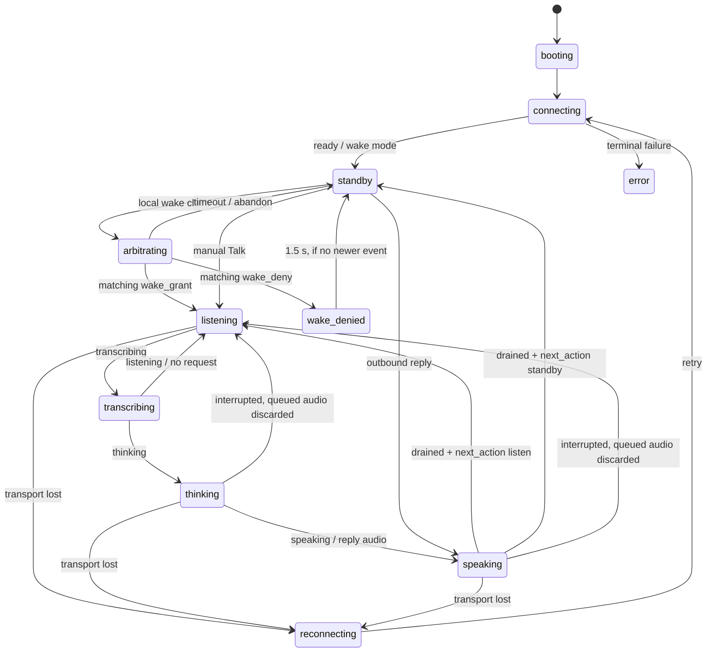

# Arya state animations

## Scope and audit snapshots

All four Arya repositories in Keryxion were inspected. A named device such as
`master`, `family`, or `MacBook Pro` is an instance, not a separate animation
implementation. Hardware renderers and independently defined effects remain
separate even where their names or colors resemble one another.

| Repository | Audited main revision | Renderers / variants retained |
|---|---|---|
| [arya-macos][mac] | `146aeea1008f241e16b73bc790e21ff51926ef5b` | Menu mark, colored-dot assets, live meter, status glyphs, audible cues |
| [arya-ios][ios] | `bc346bd9c2dddff8078e55f485ecbbcb6e2f47c7` | SwiftUI orb, rings, waveform, labels, mute decoration, Reduce Motion, haptics |
| [arya-esp32][esp] | `9f607412b8f98a35110085585e0a1ac4ffa0e368` | M5 Echo Pyramid four seven-pixel groups; HA Voice Preview Edition twelve-pixel ring |
| [arya-echo][echo] | `0bf5754790a01d2c9ae94ad8b4508e254abda9d2` | Stock LED ring, generated/custom ring effects, screen band, animated face, single-LED renderer |

Echo device directories are retained individually: `donut` (Dot 3), `biscuit`
(Dot 2), `radar` (Echo 2), `checkers` (Show 5 gen 1), `crown` (Show 8 gen 1),
`cronos` (Show 5 gen 2), `athena` (Show 8 gen 2), and `cupcake` (Echo Input).
The four Show ports select the band plus screen UI; cupcake has one RGB LED.
Presence of a device directory is not a claim of equal deployment maturity:
[the device inventory][echo-devices] records tested and in-progress ports.
Other products in `devices/MODELS.md` do not acquire an implementation merely
by being listed there.

## Proposed shared state model

A renderer consumes **one primary phase**, privacy/availability flags, and
optional bounded overlays. It must not derive semantic state from color or
from an arbitrary microphone-level threshold. Animation must never change the
voice protocol, delay audio, grant a wake, or decide that speech is a barge-in.

| State ID | Meaning / entry | Shared color | Shared animation and exit |
|---|---|---|---|
| `booting` | Local initialization | Neutral | One 400 ms fade-in; leave when initialization completes, or show the actual failure |
| `unconfigured` | Connection/settings required | Orange | Clockwise chase, 1.38 s/lap; persist until configured |
| `connecting` | Opening transport or awaiting `ready` | Blue | Smooth 1.6 s brightness breath; never imply readiness to speak |
| `reconnecting` | Lost transport; retry scheduled/in progress | Orange | Two 180 ms pulses separated by 180 ms, then a 1.46 s rest; show retry text where possible |
| `idle` | No active session or wake detector | White | Small, gently breathing or twinkling mark to show the device is alive; microphone availability is stated separately |
| `standby` | Connected; waiting for wake or manual Talk | White | Small, gently breathing or twinkling mark; ambient motion must not look like an input meter |
| `arbitrating` | Local wake accepted; claim awaiting decision | Orange | Smooth 1 s breath, 35–100% of configured state brightness; no listening cue yet |
| `wake_denied` | Matching explicit `wake_deny` | Red | Steady for 1.5 s, then standby; a later state cancels the expiry timer |
| `listening` | Granted activation, manual Talk, or explicit follow-up listening | Green | Steady status accent plus a meter driven by actual input PCM; baseline is static |
| `transcribing` | Speech capture has ended and transcription is in progress | Yellow | Yellow indication while transcription is in progress; distinct from green listening and orange thinking |
| `thinking` | Transcription completed and the agent turn has started | Orange | Clearly animated while thinking; spatial displays can orbit, while a single LED can breathe |
| `speaking` | Reply queued/playing, including its local tail | Blue | Large, prominent animated indication; on LED-only devices use a prominent blue animation, optionally driven by the actual rendered-output envelope |
| `error` | Connection, authentication, capture, or playback failure requiring attention | Strong red | Pulse persistently to show a fault; show error text or a warning symbol where available. Do not rotate: rotation suggests work is in progress |
| `ended` | Explicitly ended session | Neutral | A 600 ms fade to idle; this is not wake standby unless local wake remains armed |

Muted uses a softer steady red than the strong pulsing red used for faults.
LED-only devices communicate these distinctions through color, brightness, and
motion; icons and text are optional supplements on devices that have screens.

Palette tokens, expressed in display sRGB: neutral `#FFFFFF` on dark surfaces
and `#111111` on light surfaces; orange/thinking `#FF9500`; amber `#FFB000`; green
`#34C759`; speaking blue `#32ADFF`; blue `#3478F6`; fault red `#FF3B30`;
auxiliary violet `#AF52DE`. Hardware applies its calibrated brightness/gamma;
these values are not raw PWM duties or instructions to run LEDs at full power.

A **wake timeout is not a denial**: return to standby without red and without
claiming another device won. `ready` by itself does not grant a wake activation.
Manual Talk can enter listening without arbitration. An outbound reply can
enter thinking/speaking from standby without claiming the device won a wake.

### Event boundaries

This diagram is a presentation summary, not a replacement for `client spec.md`.
In particular:

- Keep the speaking phase through **local playback drain**, even if `turn_done`
  has arrived. Apply `next_action` after drain/discard; do not flash green while
  old reply audio is still queued.
- `working` keeps thinking alive; it does not restart the animation or indicate
  new transcript/output progress. A spinner is not a percentage-complete meter.
- A valid `interrupted` cancels queued audio and returns to the protocol's
  listening state; do not invent an error or a second transcript for the
  interruption-only audio. Repeated/stale frames must not repaint a retired turn.
- VAD decisions belong to the audio/server implementation. A visually quiet
  input meter is not proof that interruption was impossible, nor is a moving
  meter a reason for the UI to cancel playback.
- A state change supersedes pending overlays. New Talk, wake, outbound output,
  mute, disconnect, cancellation, and teardown invalidate a denial timer.
- No old volume/transcript meter may cover a new phase's status accent.

## Privacy, availability, and overlays

`muted`, `wake_armed`, `connected`, and `do_not_disturb` are orthogonal flags.
They must not be collapsed into the primary voice phase.

- **Muted:** persistent, soft, steady red mute indication and explicit microphone-off
  label where text is available. Never show a green listening claim while muted.
  Stop input meters and decorative speech-like motion. Reply playback can remain
  possible; a screen can retain a separate cyan output meter with a persistent
  red mute badge. A single LED uses the privacy red, not a misleading green.
  Muted is visually distinct from the stronger pulsing red fault indication.
- **Unmute:** remove privacy red only after the microphone is actually available.
  Restore the current state, not a cached pre-mute animation. An optional red
  fade-out must not postpone capture or hide a new error.
- **DND:** violet badge / bounded 1.76 s violet pulse; DND is not microphone mute.
- **Error while muted:** retain the mute indicator and expose the error via
  text/symbol or a distinguishable error pattern. Do not lose privacy information
  behind volume, identify, or thinking decorations.
- **Volume:** a neutral/white proportional bar for 1.5 s; distinguish output
  volume from microphone input level. Privacy and faults remain visible.
- **Transcript acknowledgment:** one 360 ms amber swell at the transition to
  thinking. It is an overlay, not a phase or a delay before processing starts.
- **Interrupted/end acknowledgment:** optional bounded fade only after actual
  discard/drain; no red denial, success flash, or new listening cue by inference.

For single-surface devices, privacy and actionable faults outrank transient
volume/identify decoration; the active voice phase outranks ambient effects.
Timers/calls/setup occupy a separate auxiliary channel or temporarily replace
ambient presentation. Restore the **current** underlying state when they finish.
Existing Echo and Voice PE overlay orders differ; this ordering is a migration
proposal, not a statement that they already implement it.

## Renderer adaptations

| Renderer | How to preserve the shared meaning |
|---|---|
| macOS mark | Keep the neutral `)` arc visible in every phase; color/animate only the dot. Retain the dot beside the live meter. Use a white arc with a thin dark edge where a colored non-template image is needed; app appearance alone does not determine menu-bar contrast. Provide 1x/2x assets. |
| iOS orb | Apply the phase color to the orb/rings; show a real input envelope only during listening and a real output envelope during speaking. Keep labels and microphone status visible. Decorative breathing must not masquerade as measured speech. |
| Voice PE ring | Use the ring geometry for orbit/chase; green listening, orange thinking, blue speaking. Preserve a visible privacy marker and avoid high-rate writes that affect audio. |
| Pyramid groups | Treat four seven-pixel groups as a mapped surface; repeated groups may mirror the same phase. A hardware-limited static color is an explicit fallback, not a different semantic state. Retain the volume bar and its restore behavior. |
| Echo native ring | Use the board/firmware's actual LED count and orientation; preserve talker direction where available. A theme supplies geometry, not permission to swap listening and speaking meanings. |
| Echo screen band | Unroll the ring with the talker at the center, preserving phase, duration, and colors. Keep the level band tied to real audio. |
| Echo face | Preserve eye/mouth expression as a second channel: listening attentive, thinking searching, speaking mouth driven by output. Apply the shared semantic color/badge alongside the expression; the face and band must agree. |
| Echo Input / one RGB LED | Replace spatial motion with its documented breath/pulse fallback. Never rotate a single lit pixel out of view. No directional indication or multi-pixel volume precision is claimed. |

When Reduce Motion is enabled, use static state color plus text/icon/shape and a
non-animated measured level where practical. Where available, use text, icons, or
shapes in addition to color; LED-only devices rely on color, brightness, and motion.
Brightness, night mode, and ambient-light adjustment scale output without
changing state meaning. Use monotonic time for animation periods, independent
of frame rate; cap rendering to hardware capacity. No animation work may block
capture, network audio, TTS, or playback acknowledgments.

The winning device plays a brief, quiet wake confirmation locally immediately
on a matching `wake_grant`. A denied, timed-out, or stale claim makes no sound;
manual Talk does not play the wake-grant cue. The cue must not wait for server
TTS or cause a local wake or server interruption. Keep the cue unobtrusive.
The falling pair (784 then 523 Hz) acknowledges endpointing. Listening
confirmation may also sound for manual Talk or actual follow-up readiness; it
must not be mistaken for a wake-grant cue.

While thinking, play a quiet thinking sound so a listener without a screen or
visible LEDs knows work is in progress. Stop it promptly when thinking ends,
including on speaking, interruption, cancellation, or error. It must not delay,
mask, or overlap the assistant's speech, block audio processing, or cause a wake
or interruption. Keep sound volume bounded and configurable.

## Current implementation inventory

### macOS

Sources: [state and tray renderer][mac-main], [meter][mac-renderer],
[status asset generator][mac-assets], [tones][mac-tones].

| Existing state / surface | Observed implementation |
|---|---|
| `idle`, `asleep` with detector armed | Neutral template dot-and-arc mark; unarmed idle uses the fallback status glyph path |
| `connecting` | Microphone glyph plus ten-frame Braille spinner, 90 ms updates |
| `arbitrating` | Orange dot with the arc retained; current asset is steady, not a pulse |
| `wake-denied` | Red dot for 1.5 s, cancelled by subsequent lifecycle actions; timeout does not use denial red |
| `listening` | Green dot; neutral arc and actual input-history meter beside it |
| `thinking` | Orange status glyph plus spinner; the current implementation does not yet keep the full mark in this phase |
| `speaking` | Speaker glyph and neutral output meter; this differs from the proposed cyan-dot presentation |
| `error` | Warning-triangle glyph and menu error text |
| mute | Red status glyph; error remains independently visible; microphone is released |
| meter | 34 samples of history, nominally ~2.7 s at 80 ms; listening mark uses a 44-device-pixel offset; speaking uses the neutral template-meter path |
| status assets | Pending, denied, listening × light/dark names × 1x/2x. Current generator gives both named themes the same white arc/dark outline; retain all filenames as compatibility variants rather than assuming other revisions did so. |
| cue variants | Rising listening and falling endpoint pairs; separate from the visual spinner and meter |

### iOS

Sources: [state palette][ios-state], [orb and haptics][ios-orb],
[wake protocol][ios-protocol], [client lifecycle][ios-client].

| Existing state / effect | Observed implementation |
|---|---|
| `idle`, `ended` | Inactive orb takes mint fallback; declared state palette is gray |
| `connecting`, `thinking` | Orange declared tint; spring phase transitions, response 0.45 s, damping 0.85 |
| `standby` | Gray active-state tint; local wake readiness is represented in labels; manual and wake standby have different microphone descriptions |
| `listening` | Mint orb/waveform driven by input level |
| `speaking` | Cyan orb/waveform driven by reply level |
| `error` | Declared state color is red, but `VoiceOrb`'s inactive fallback selects mint; text/error surfaces must be distinguished from the actual orb tint |
| mute | Orange orb/control decoration, not the proposed privacy red |
| orb/rings | Three concentric rings, radial inner disc, glow; sinusoidal scale amplitude 0.035 at angular frequency 1.8 rad/s; level adds up to 0.07 scale |
| waveform | 17 capsules, phase-offset sine decoration; thinking/connecting use fixed 0.18 intensity; muted intensity is zero but the decorative baseline can still animate |
| render policy | 24 Hz `TimelineView`; Reduce Motion pauses the timeline; inactive state also pauses it |
| haptics | SwiftUI selection feedback on state changes |
| wake arbitration | `detecting`, `pending`, `active` exist in `WakeActivation`; no distinct pending-orange or denied-red `SessionState` in this revision |

### ESP32: retain both board implementations

Sources: [shared state enum][esp-enum], [Pyramid renderer][esp-pyramid],
[Voice PE renderer][esp-vpe], [protocol-driven transitions][esp-ws].
RGB values below are the implementation's channel values **before** hardware
brightness handling, not normalized semantic palette tokens.

| Shared enum | Pyramid RGB / behavior | Voice PE RGB / behavior |
|---|---|---|
| `BOOT` | `(48,36,18)` warm solid | `(8,8,8)` solid |
| `WIFI_CONNECTING` | `(0,32,96)` blue solid | `(0,0,40)` blue solid |
| `IDLE` | `(0,16,12)` dim teal solid | Actual idle uses dim-white, independent per-pixel breathing; nominal solid idle is off |
| `WAKE` | `(96,96,96)` white solid | `(40,0,60)` purple solid |
| `CONNECTING` | `(56,16,96)` violet solid | `(0,0,40)` blue solid |
| `LISTENING` | `(0,72,96)` cyan solid | `(0,60,0)` green solid |
| `TRANSCRIPT` | `(16,6,0)` dim amber solid | 360 ms amber swell, levels `4,8,14,20,24,20,14,8,4`, green channel at 2/5 |
| `THINKING` | `(32,12,0)` amber solid | Amber orbit, 160 ms/LED step, three-pixel fading trail, 1.92 s/lap for twelve LEDs |
| `SPEAKING` | `(0,96,28)` green solid | `(0,30,60)` cyan/blue solid |
| `ERROR` | `(96,0,0)` red solid | `(80,0,0)` red solid |
| `MUTE` | Implemented via overlay `(96,0,0)`; not a separate explicit color-switch case | `(28,0,0)` dim-red solid overlay |
| volume overlay | `(80,80,96)`, proportional fill of each seven-pixel group; 1.5 s | `(24,16,4)` warm-white proportional twelve-pixel bar; 1.5 s |

Voice PE uses a 40 ms task tick, changes orbit position every four ticks, and
updates idle breathing every fifth tick. Idle breaths vary independently per
pixel over approximately 2.8–5 s and channel brightness 1–7. Its current overlay
order is volume, mute, transcript acknowledgment, thinking chase, idle breathing,
solid state. Pyramid writes static state colors over I2C and has a separate
volume expiry timer. These are distinct mechanisms, not deduplicated effects.

The enum contains legacy/wake/setup states even where a code path does not
currently select them. The cooperative path explicitly selects listening only
after grant and uses a wake cue; the inspected enum has no dedicated denied
state. Do not claim that merely having `WAKE` implements the Mac pending/denied UX.

### Echo: protocol state, stock ring, screen band, and themes

Sources: [core phase mapping][echo-main], [native ring/slot registry][echo-ring],
[screen-band implementation][echo-band], [Converse adapter][echo-converse].
Core phases are `IDLE`, `LISTENING`, `THINKING`, `SPEAKING`. They select no active
pattern, `active-start`, `active-thinking`, `active-talking`, respectively;
returning to idle plays `active-end`. The Converse adapter has separate claim
bookkeeping, but no additional core pending/denied visual phase in this revision.

Every slot in the native-ring and band registries is retained here. The band
implements the following source-defined timing; native firmware may differ.
Stock ring files are loaded from device firmware, not vendored `.animation`
files in this repository, so byte/timing equivalence across models is unverified.

| Slot ID | Pattern / family | Screen-band reference behavior |
|---|---|---|
| `listen` | `active-start` | Blue fills toward the talker in 500 ms; cyan at center/talker, width responds to input |
| `end` | `active-end` | Blue/cyan closes from talker outward in 600 ms |
| `think` | `active-thinking` | Alternating blue/cyan pixels change every 100 ms |
| `talk` | `active-talking` | Whole band breathes cyan to blue, 1690 ms period |
| `error` | `anim_start_error_short` | Three red pulses, 1100 ms each; ends at 3300 ms |
| `timer` | `ready-timer` | Alternating three-pixel cyan/blue groups, 375 ms steps; persists until unset |
| `timer_short` | `ready-timer-short` | Same family, bounded 2233 ms; retained separately |
| `volume` | `volume_step-NN` | White proportional volume; step count is device-specific |
| `assist_volume` | `hassmic_assist_NN` | Cyan proportional assistant volume; separate control and family |
| `mute` | `mics-off_on` | Red settles from bright to 60% over 700 ms, then persists |
| `unmute` | `mics-off_end` | Red fades out over 1100 ms |
| `dnd` | `do_not_disturb` | Violet pulse lasting 1760 ms |
| `identify` | `zzz_rainbow` | Rotating rainbow, 2 s period |
| `bt_pairing` | `scone-setup` | Single blue runner, 1060 ms/lap |
| `call_out` | `call_outbound_ringing` | Green arc, 900 ms/lap, fading trail |
| `call_in` | `call_incoming` | Green paired pixels pulse/advance over 1300 ms |
| `call_live` | `call_connected` | Green travelling waves, 2400 ms/lap |
| `call_end` | `call_connected_end` | Green moves from middle toward ends over 1480 ms |
| `setup` | `setup-mode` | Orange runner, 1380 ms/lap |
| `reset` | `factory-reset` | Orange pulse, 830 ms period, until unset |
| `login` | `authenticated_setup_mode` | Blue breath, 1800 ms period, until unset |

`active-start` and `active-end` have direction-aware native variants; the
similarly named firmware `ca-*` family is not assumed equivalent. Stock turns,
custom design turns, volume steps, and assistant-volume steps remain distinct
variants even when the UI labels are similar.

Additional [custom light effects][echo-ring] are **None/solid** (static frame),
**Pulse** (24 × 100 ms frames, 35–100% brightness), **Spin** (two opposed heads,
approximately 1 s/lap), **Blink** (500 ms on / 500 ms off), and **Rainbow**
(2 s/lap). Spin is not offered on a single LED. These are ambient/light effects,
not evidence that Arya is listening. User-authored designs/theme packs may
replace any available slot; retain their IDs, frame durations, loop point,
LED count, and source pack. Installed designs are runtime/user data and were
not exhaustively fetched or deduplicated in this source audit.

The band is a separate renderer, normally 30 Hz, with twelve logical positions
unrolled into screen pixels. It and the native ring have their own priority
composition. Firmware-only stock animations outside the 21 registered Arya slots
are not asserted to have been cataloged: the source describes a stock set of
roughly 266 loaded files, but does not ship that per-device inventory. Preserve
unknown installed entries as additional variants when a device export is added.

### Echo screen face: retain its independent animations

Sources: [face renderer][echo-face], [scene contract][echo-scene]. This renderer
is not a ring skin. Its expressions and overlays must not be dropped just
because it consumes many of the same pattern names.

| Existing face mode / effect | Observed behavior |
|---|---|
| `M_IDLE` | Pale neutral eyes; idle glances and blinks; clock / optional music UI |
| `M_LISTEN` | Cyan attentive eyes, height grows with input level |
| `M_THINK` | Pale blue; one eye shorter; gaze searches horizontally over 1.6 s and looks upward |
| `M_TALK` | Pale cyan eyes and mouth driven by reply level |
| `M_TIMER` | Amber alert eyes, vertical bob; timer text/buttons |
| `M_ERROR` | Half-height red eyes, downward gaze |
| `M_MUTE` | Thin closed red eyes; blinking disabled |
| `M_DND` | Thin violet eyes, dimmed; blinking disabled |
| `M_CALL_IN` | Green, vertical bob at incoming-call cadence |
| `M_CALL_OUT` | Green gaze movement, 1.8 s period |
| `M_CALL` | Green connected-call expression |
| `M_RESET` | Half-height orange eyes |
| `M_IDENTIFY` | Hue cycle, 2 s period |
| `M_LOGIN` | Blue breathing eye height, 1.8 s period |
| `M_PAIRING` | Blue gaze oscillation, 2 s period |
| `M_SETUP` | Orange expression with more frequent glances |
| blink | 180 ms close/open, next blink randomized approximately 2.5–6.5 s later |
| idle/setup glance | Idle chooses a new target approximately every 1.8–6 s; setup every 0.9–2.1 s |
| touch/poke | Squinting smile toward finger for 900 ms |
| mode transitions | Independent eased eye size, gaze, color, brightness, and mouth geometry |
| music/drawer/clock | Separate screen/UI transitions and progress/clock updates; retain as application animations, not voice-state aliases |

The face also consumes bounded end/unmute/call-end pattern events; those do not
have separate entries in its 16-mode enum. Its current priority favors calls and
voice phases over mute; the proposed persistent privacy indication above is an
explicit change to that behavior. Do not report this proposal as already shipped.

## Consolidated auxiliary set

The following names retain all observed non-voice families. A client without
the underlying function does not fabricate the state. Echo-local timers/calls
already exist; Converse timer/synchronized-announcement extensions remain
subject to `client spec.md` and are not implemented by this document.

| Shared auxiliary ID | Retained variants | Proposed shared rendering |
|---|---|---|
| `volume.output` | Hardware volume steps / Mac/iOS controls | Neutral proportional bar, 1.5 s |
| `volume.assistant` | Echo assistant-volume steps | Cyan proportional bar, 1.5 s; explicit assistant-volume label |
| `transcript_ack` | Voice PE swell; Mac endpoint tone | One amber 360 ms swell; endpoint cue may accompany it |
| `mute.on`, `mute.off` | Red latch / bounded unmute fade | Persistent privacy red; restore actual state after unmute |
| `dnd` | Ring pulse / closed-eye face | Violet badge, optional bounded 1.76 s entry pulse |
| `identify` | Rainbow ring / face | Bounded rainbow display, 2 s color cycle; explicit user action |
| `bluetooth.pairing` | Blue runner / blue moving eyes | Blue chase, ~1.06 s/lap; no listening implication |
| `call.outgoing` | Green arc / searching green face | Green 900 ms orbit with call label/icon |
| `call.incoming` | Green paired pulse / bobbing face | Green 1.3 s pulse with incoming-call label/icon |
| `call.active` | Green waves / connected face | Green 2.4 s travelling wave with call label/icon |
| `call.ended` | Separate 1480 ms end event | Bounded 1.48 s green fade/travel, then current state |
| `timer.ringing` | Indefinite timer pattern / amber face | Alert decoration distinct from voice listening; preserve explicit timer label and stop control |
| `timer.notice` | Bounded short-timer variant | Bounded 2233 ms timer pattern; do not merge with indefinite ringing |
| `setup.required` | Orange runner / orange face | Orange 1.38 s chase and setup instructions |
| `reset.confirmation` | Orange pulse / reset face | Orange 830 ms pulse only during explicit reset flow |
| `authentication.pending` | Blue breath / login face | Blue 1.8 s breath and explicit action label |
| `ambient.solid`, `.pulse`, `.spin`, `.blink`, `.rainbow` | Echo light effects | Preserve user-selected effect only when not covering voice/privacy/fault state |
| `face.blink`, `.glance`, `.touch` | Independent face embellishments | Retain as secondary expression, suppressed when inappropriate for privacy/Reduce Motion |
| `custom.<pack>.<design>` | All installed user designs | Preserve identity/timing/geometry; require explicit mapping before claiming canonical-state equivalence |

## Migration and acceptance checks

1. Preserve this audited inventory. Map known aliases explicitly; retain all
   uncertain duplicates and runtime custom entries with provenance.
2. Implement the core palette/state meanings in each renderer. The Pyramid's
   current cyan listening / green speaking and Echo's blue/cyan thinking are
   explicit migration items, not the new defaults by implication.
3. Add missing arbitration presentation to iOS, ESP32, and Echo without changing
   grant timing, the 1 s client deadline, audio buffering, or fail-closed behavior.
4. Keep a neutral arc visible on dark and light Mac menu bars, with and without
   meters, at 1x and 2x. Confirm the colored dot never becomes the entire logo.
5. Exercise grant, denial, timeout, manual Talk, mute/unmute, reconnect, stale
   denial expiry, outbound reply, error, and settings/model changes in every
   phase. A settings change is not a new voice phase or a reason to replay a cue.
6. Feed real microphone/reply envelopes, silence, quiet speech, and noise.
   Listening meters use input; speaking meters use rendered output; neither
   continues with stale/fabricated data after cancellation or a phase change.
7. Send `turn_done` while several seconds remain queued: stay speaking until
   drained. Barge in during thinking, playback, and its tail: discard audio,
   acknowledge drain, and show the current protocol state without stale timers.
8. Validate volume, privacy, faults, DND, timer/call overlays, ambient effects,
   one-LED fallback, directional geometry, Reduce Motion, low brightness, and
   device-specific write budgets. Verify that animation does not affect audio.
9. Export installed Echo slot/design inventories before replacing user themes;
   keep unknown/custom variants. Source audit cannot certify firmware-only or
   user-authored visuals that were not exported.

[mac]: https://github.com/Keryxion/arya-macos/tree/146aeea1008f241e16b73bc790e21ff51926ef5b
[mac-main]: https://github.com/Keryxion/arya-macos/blob/146aeea1008f241e16b73bc790e21ff51926ef5b/electron/main.ts
[mac-renderer]: https://github.com/Keryxion/arya-macos/blob/146aeea1008f241e16b73bc790e21ff51926ef5b/src/renderer.ts
[mac-assets]: https://github.com/Keryxion/arya-macos/blob/146aeea1008f241e16b73bc790e21ff51926ef5b/build/make-tray-status-icons.py
[mac-tones]: https://github.com/Keryxion/arya-macos/blob/146aeea1008f241e16b73bc790e21ff51926ef5b/src/tones.ts
[ios]: https://github.com/Keryxion/arya-ios/tree/bc346bd9c2dddff8078e55f485ecbbcb6e2f47c7
[ios-state]: https://github.com/Keryxion/arya-ios/blob/bc346bd9c2dddff8078e55f485ecbbcb6e2f47c7/Arya/Session.swift
[ios-orb]: https://github.com/Keryxion/arya-ios/blob/bc346bd9c2dddff8078e55f485ecbbcb6e2f47c7/Arya/SessionView.swift
[ios-protocol]: https://github.com/Keryxion/arya-ios/blob/bc346bd9c2dddff8078e55f485ecbbcb6e2f47c7/Arya/VoiceProtocol.swift
[ios-client]: https://github.com/Keryxion/arya-ios/blob/bc346bd9c2dddff8078e55f485ecbbcb6e2f47c7/Arya/VoiceClient.swift
[esp]: https://github.com/Keryxion/arya-esp32/tree/9f607412b8f98a35110085585e0a1ac4ffa0e368
[esp-enum]: https://github.com/Keryxion/arya-esp32/blob/9f607412b8f98a35110085585e0a1ac4ffa0e368/main/pyramid_leds.h
[esp-pyramid]: https://github.com/Keryxion/arya-esp32/blob/9f607412b8f98a35110085585e0a1ac4ffa0e368/main/pyramid_leds.c
[esp-vpe]: https://github.com/Keryxion/arya-esp32/blob/9f607412b8f98a35110085585e0a1ac4ffa0e368/main/vpe_leds.c
[esp-ws]: https://github.com/Keryxion/arya-esp32/blob/9f607412b8f98a35110085585e0a1ac4ffa0e368/main/voice_ws.c
[echo]: https://github.com/Keryxion/arya-echo/tree/0bf5754790a01d2c9ae94ad8b4508e254abda9d2
[echo-devices]: https://github.com/Keryxion/arya-echo/blob/0bf5754790a01d2c9ae94ad8b4508e254abda9d2/devices/README.md
[echo-main]: https://github.com/Keryxion/arya-echo/blob/0bf5754790a01d2c9ae94ad8b4508e254abda9d2/src/hassmic/main.c
[echo-ring]: https://github.com/Keryxion/arya-echo/blob/0bf5754790a01d2c9ae94ad8b4508e254abda9d2/src/hassmic/ring.c
[echo-band]: https://github.com/Keryxion/arya-echo/blob/0bf5754790a01d2c9ae94ad8b4508e254abda9d2/src/hassmic/ring_band.c
[echo-converse]: https://github.com/Keryxion/arya-echo/blob/0bf5754790a01d2c9ae94ad8b4508e254abda9d2/src/hassmic/proto_converse.c
[echo-face]: https://github.com/Keryxion/arya-echo/blob/0bf5754790a01d2c9ae94ad8b4508e254abda9d2/src/ui/face.c
[echo-scene]: https://github.com/Keryxion/arya-echo/blob/0bf5754790a01d2c9ae94ad8b4508e254abda9d2/src/ui/scene.h
